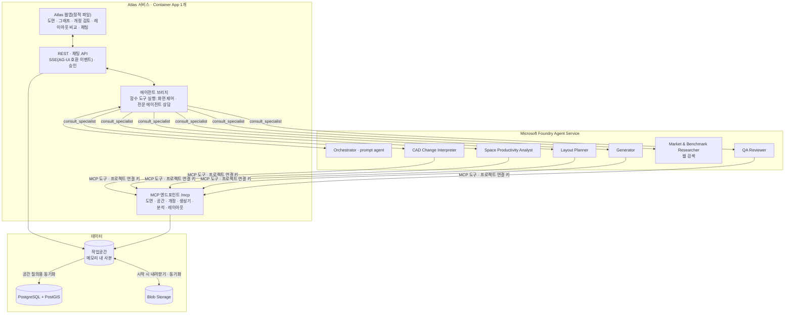

# 아키텍처

## 1. 목표

이 플랫폼은 백화점 CAD 도면을 버전 관리되는 **공간관계 모델**로 이해한다. 도면이 바뀌면 Foundry 에이전트가 아래 순서로 처리한다.

1. 변경을 해석한다.
2. 영향을 분석한다.
3. 파생 산출물을 재생성한다.
4. 사람이 검토하고 승인한다.

같은 모델 위에서 공간 생산성 진단과 레이아웃 대안 생성(what-if)을 수행한다. 유스케이스는 고정하지 않는다. 생성기 플러그인과 도구 조합으로 확장한다.

## 2. 계층 구조

**구현 메모**

- Orchestrator는 prompt agent다. 화면 제어와 전문 에이전트 상담은 클라이언트 측 함수 도구로 정의하고, Atlas의 에이전트 브리지가 실행한다. 필요하면 hosted agent로 바꿀 수 있다.
- 전문 에이전트는 Foundry 프로젝트 연결(`RemoteTool`, 사용자 지정 키)을 통해 Atlas의 `/mcp`를 호출한다. 에이전트별로 허용 도구를 제한한다.
- 개정 업로드 이벤트의 자동 처리는 아직 연결하지 않았다. 현재는 API(`POST /api/revisions/{rev}/process`)로 처리한다.

## 3. 에이전트

| 에이전트 | 형태 | 역할 | 도구 |
|---|---|---|---|
| Orchestrator | Prompt agent + Atlas 에이전트 브리지(함수 도구) | 자연어 진입, 계획, 라우팅, 개정 workflow, 승인 요청, 화면 제어 이벤트 | 전문 에이전트 상담, 화면 제어 함수, MCP 조회 도구 |
| CAD Change Interpreter | Prompt agent | 도면 의미 해석, 개정 diff를 업무 언어로 요약, 신뢰도가 낮은 항목 확인 요청 | `cad.*`, `revision.*`, `spatial.*` |
| Space Productivity Analyst | Prompt agent | 평효율, GMROF, 노출도, 교차구매, 층간 이동, 개편 전후 비교, 원인 분해 | `analytics.*`, `spatial.*`, Code Interpreter |
| Layout Planner | Prompt agent | 제약 기반 배치 대안 생성(가상 개정), 비교, 설명 | `layout.*`, `whatif.*`, `revision.*` |
| Generator | Prompt agent | 등록된 생성기 실행, 즉석 산출물 조합, 등록안 제안 | `registry.*`, `render.*` |
| Market & Benchmark Researcher | Prompt agent | 공개 업계 동향과 벤치마크 조사(인용 포함) | 웹 검색, 파일 검색 |
| QA Reviewer | Prompt agent | 검증 규칙 실행, 승인 패키지 작성 | `registry.validate`, `spatial.*` |

**웹 검색 규칙**

- 웹 검색(Grounding with Bing)은 Researcher에게만 부여한다.
- 질의에 내부 데이터, 고객 정보, 고객명을 넣지 않는다.

## 4. 핵심 설계 원칙

- **계산과 해석의 분리:** LLM은 도구 선택, 의미 해석, 설명을 맡는다. 면적, 거리, 인접, diff, 점수, 레이아웃 탐색은 결정론적 코드가 계산한다.
- **What-if와 레이아웃 대안:** `kind=hypothetical` 개정으로 표현한다. 실제 개정과 같은 루프에서 처리하고, DXF로 왕복 내보내기를 지원한다.
- **재생성 관리:** 재생성은 멱등으로 만들고, 위험도에 따라 승인 게이트를 다르게 적용한다.
- **화면 변경:** 이벤트로 처리한다. 예: `highlight`, `heatmap`, `edges`, `focus`, `compare`, `layout_compare`
- **좌표계:** 로컬 공학 좌표(m, SRID 0)를 쓴다. 지도 서비스에 의존하지 않는다.

## 5. 개정 루프

**상태 전이**

`uploaded → parsed → modeled → diffed → impact_planned → regenerated → qa_checked → awaiting_approval → published | rejected`

**diff 유형:** `add`, `remove`, `move`, `resize`, `reassign`, `split`/`merge`, `fixture_change`, `walkway_change`

**영향 분석:** 생성기 레지스트리에 선언된 의존성과 change set을 매칭한다.

## 6. Azure 구성

| 구분 | 리소스 |
|---|---|
| AI | Foundry 리소스·프로젝트, 모델 배포, prompt agent, MCP 프로젝트 연결, Tracing·Evaluation |
| 컴퓨팅 | Container Apps: `atlas` 1개(웹·API·MCP). 작업공간을 메모리에 두므로 복제본을 1개로 고정한다. |
| 데이터 | Azure Database for PostgreSQL flexible server(PostGIS) |
| 저장소·이벤트 | Storage(Blob, Queue). Event Grid 시스템 토픽은 만들었지만 구독은 아직 없다. |
| 보안·운영 | Container Registry, Key Vault, Application Insights, Managed Identity, Entra ID |
| 배포 | Bicep + Azure Developer CLI |

다음은 사용하지 않는다.

- Azure Maps: 한국에서 사용할 수 없다.
- 기존(classic) Foundry 에이전트: 2027-03-31 종료된다.
- Foundry의 Fabric data agent 연동: 2026-11-06 종료된다.
- Assistants API: 이미 종료됐다.
