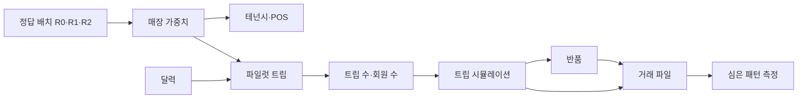

# 합성 업무 데이터 생성기

이 문서는 `cad2anything.mockgen.business`가 만드는 합성 업무 데이터의 설계, 보정 근거, 심은 패턴, 한계를 설명한다.

> **면책:** 이 생성기가 만드는 데이터는 모두 합성 데이터다. 브랜드명은 모두 가상이며 실제 기업·고객·매출과 관계가 없다. 공개 통계는 분포의 대략적 모양을 잡는 데에만 참고했고 실제 수치를 복제하지 않았다.

## 1. 범위와 실행

| 항목 | 내용 |
|---|---|
| 입력 | 도면 정답 모델 `R0`·`R1`·`R2`와 가상 브랜드 목록. `H1`은 가상 개정이므로 거래를 만들지 않는다. |
| 보정 파일 | `src/cad2anything/mockgen/calibration.yaml`. 모든 파라미터는 `value`와 `source`를 가진다. |
| 출력 위치 | 전체 데이터는 `data/generated/business/`(Git 제외), 소형 샘플은 `data/samples/business/`(커밋) |
| 기간 | 2024-10-01 ~ 2026-09-30(730일) |

다음 명령으로 전체 데이터와 샘플을 만든다. `--scale`을 생략하면 보정 파일의 기본값 0.02를 쓴다. 같은 seed와 scale로 실행하면 같은 결과가 나온다.

```powershell
uv run --no-sync python -m cad2anything.mockgen.business --out data/generated --seed 42 --samples data/samples
```

| 파일 | 내용 |
|---|---|
| `categories.csv` | catalog의 카테고리 기준값과 목표 매출 비중 |
| `brands.csv` | 가상 브랜드. 열은 `Brand` 데이터 클래스의 필드와 같다. |
| `tenancies.csv` | `brand_id`, `unit_code`, `rev_id`, `valid_from`, `valid_to`, `commission_rate` |
| `pos_terminals.csv` | `pos_id`, `brand_id`, `unit_code`, `valid_from`, `valid_to` |
| `customers.csv` | `pseudo_id`, `age_band`, `gender`, `tier`, `join_date`, `home_area` |
| `calendar.csv` | 날짜별 요일, 공휴일, 명절, 영업시간, 트래픽 지수, 적용 개정 |
| `transactions.csv.gz` | `txn_id`, `ts`, `pos_id`, `customer_id`, `amount_krw`, `items`, `payment`, `is_return`, `ref_txn_id`, `weight` |
| `footfall_zone_hourly.csv.gz` | 존·시간대별 추정 방문수(선택 파일) |
| `planted_effects.json` | 심은 패턴의 파라미터, 기대 신호, 생성 데이터에서 측정한 관측값 |
| `data_card.md` | 생성 시점의 행 수와 요약을 담은 데이터 카드 |

샘플 폴더에는 `categories.csv`, `brands.csv`, `tenancies.csv`, `pos_terminals.csv`, `planted_effects.json`과 4개 날짜의 거래 전체(`transactions_sample.csv`), 그 거래에 나오는 회원(`customers_sample.csv`)을 둔다. 샘플 거래에는 반품이 참조하는 원거래도 포함한다.

## 2. 데이터 규칙

- `valid_from`과 `valid_to`는 모두 그날을 포함한다. 거래의 POS 매핑은 `valid_from <= 거래일 <= valid_to`인 행으로 찾는다.
- 테넌시는 개정마다 1행이다. 적용 기간은 `R0` 2024-10-01 ~ 2025-02-28, `R1` 2025-03-01 ~ 2025-08-31, `R2` 2025-09-01 ~ 2026-09-30이다.
- 수수료율은 브랜드마다 한 번 정하며 catalog 카테고리 범위 안에서 0.5%p 단위로 뽑는다.
- 브랜드는 첫 매장 면적에 따라 POS를 1~4대 받는다(60㎡ 이하 1대, 150㎡ 이하 2대, 300㎡ 이하 3대, 그 밖 4대).
- 브랜드가 매장을 옮기면 `pos_id`는 그대로이고, 이동일부터 `unit_code`만 바뀐 새 행이 시작된다.
- `ts`는 Asia/Seoul 현지 시각이며 타임존을 표기하지 않는다.
- 반품은 원거래와 같은 브랜드의 POS에서 1~30일 뒤에 일어난다. 반품일은 그 브랜드의 테넌시 기간과 데이터 기간 안에 있다.
- 반품의 `amount_krw`는 원거래 금액의 음수이고 `ref_txn_id`는 원거래를 가리킨다. 정상 거래의 `ref_txn_id`는 비어 있다.
- 비회원 거래는 `customer_id`가 비어 있다.

## 3. 생성 방식

생성기는 **쇼핑 트립** 단위로 시뮬레이션한다. 트립은 고객 한 명이 하루에 한 번 점포를 방문해 여러 번 결제하는 과정이다. 회원은 하루에 트립을 최대 한 번만 한다. 그래서 분석에서는 회원의 `customer_id`와 날짜 조합(이하 **고객-일**)을 트립으로 다룰 수 있다.



### 3.1 매장 가중치

각 개정에서 영업 중인 매장마다 판매 가중치를 계산한다. 결제가 어느 매장에서 일어날지는 이 가중치에 비례한다.

가중치 = 면적^β × (1 + A·exp(−d/L)) × 브랜드 매력도 × 카페 인접 보정 × 이동 브랜드 보정

- β는 catalog의 `space_beta`다. 예를 들어 화장품은 0.35, 잡화는 0.08이다.
- d는 매장 중심점에서 같은 층의 가장 가까운 에스컬레이터 영역까지의 직선거리(m)다. 실제 보행 거리가 아니라 노출도 대용치다.
- A는 1.5, L은 15 m다. 에스컬레이터 앞(d 약 9 m) 매장의 노출 계수는 약 1.82이고, 외곽 밴드(d 약 45 m) 매장은 약 1.07이다.
- 브랜드 매력도는 `brands.csv`의 `attractiveness`를 그대로 곱한다.
- 카페 인접 보정과 이동 브랜드 보정은 6절의 심은 패턴 b와 h다.

### 3.2 트립 수와 회원

1. 파일럿 4만 트립을 시뮬레이션해 회원·비회원 트립당 매출과 결제 건수를 추정한다.
2. 회원 식별 영수증 비중이 65%가 되도록 회원 트립 비중을 정한다.
3. 목표 매출(연 2.0조 원 × scale × 730/365)을 트립당 매출로 나눠 전체 트립 수를 정한다.
4. 회원 수는 회원 트립 수를 회원 한 명의 기대 방문 수로 나눠 정한다.
5. 회원별 방문 수는 등급별 연 방문 수, 감마 분포 이질성(형상 1.5), 활동 기간으로 정한 기대값의 Poisson 표본이다.
6. 방문 날짜는 가입일 이후 날짜 중에서 트래픽 지수에 비례해 고른다.

### 3.3 트립 진행

1. 날짜를 달력의 트래픽 지수에 비례해 고른다. 휴점일은 지수가 0이므로 뽑히지 않는다.
2. 도착 시각을 평일·주말 시간대 프로필에서 고른다.
3. 진입층을 B1(지하철 연결) 35%, 1F 65%로 고른다.
4. 결제 건수를 1 + Poisson(등급별 λ)로 정한다. 최대 5건이다.
5. 첫 결제의 카테고리를 세그먼트(성별·연령대·등급) 선호 × 시간대 × 월 × 선물 시즌 가중치로 고른다.
6. 다음 결제는 아래 연결 규칙을 위에서부터 적용한다. 어느 규칙에도 해당하지 않으면 5단계와 같은 방식으로 고른다.
7. 카테고리의 층은 층별 매장 가중치 합에 비례해 고르고, 매장은 매장 가중치에 비례해 고른다.
8. 방문 순서를 정한다. 8F 식당 결제가 있는 트립의 80%는 식당에서 먼저 결제한 뒤 아래층으로 내려간다. 나머지 트립은 진입층에서 위층으로 올라가며, 1F로 들어온 트립은 B1을 마지막에 방문한다.
9. 결제 시각을 정한다. 첫 결제는 도착 5~25분 뒤, 다음 결제는 평균 22분 간격이다. 폐점 3분 전 이후의 결제는 버린다.
10. 금액은 catalog 객단가 × 브랜드 가격대 배수 × 등급 배수 × 시간대·인접 보정 × 로그정규 잡음으로 계산하고 100원 단위로 반올림한다.

| 연결 규칙(직전 결제 조건) | 다음 결제 | 확률 | 근거 라벨 |
|---|---|---|---|
| 40대 VIP·VVIP 여성의 콤보 트립 | 1F 화장품과 1F/2F 해외패션·명품을 함께 결제 | 해당 세그먼트 트립의 14% | planted(a) |
| B1 식품·F&B | 1F 화장품 | 0.75 × 0.85 | planted(d) |
| 3F 여성 컨템포러리 | 3F 잡화 60%, 3F 카페 40% | R0·R1 0.06, R2 0.20 | planted(h) |
| 화장품 또는 해외패션·명품 | 상대 카테고리 | 0.15 | assumption |
| 그 밖 | 같은 층의 카테고리(세그먼트 선호에 비례) | 0.15 | assumption |

### 3.4 고객 세그먼트와 금액

- 회원 등급 구성은 VVIP 0.5%, VIP 3%, GOLD 10%, MEMBER 86.5%다.
- 등급별 연 방문 수는 VVIP 40회, VIP 18회, GOLD 8회, MEMBER 2.6회다.
- 등급별 금액 배수는 VVIP 2.6, VIP 1.8, GOLD 1.3, MEMBER 1.0, 비회원 0.95다.
- 성별 구성은 여성 60%, 남성 40%다. 연령대는 30대~50대가 73%다.
- 브랜드 가격대 배수(1: 0.8, 2: 1.0, 3: 1.25)는 카테고리 안에서 평균이 1이 되도록 맞춘다.
- 결제 수단은 신용카드 70%, 백화점 카드 12%, 간편결제 11%, 현금 4%, 상품권 3%다. VIP·VVIP는 백화점 카드 비중이 32%로 높다.
- 반품률은 패션 3~5%, 명품·화장품 2% 안팎, 식품·F&B 0.1~0.5%다.

## 4. 보정 근거 라벨

`calibration.yaml`의 모든 파라미터는 `source`에 아래 라벨 중 하나 이상을 적는다.

| 라벨 | 의미 |
|---|---|
| spec | 저장소 문서(`docs/specs/data-layout.md`, 시장조사 문서 §6-5)가 정한 값 |
| approx. shape informed by public statistics | 산업통상자원부 주요 유통업체 매출 동향, KOSIS 소매판매액지수(백화점), 서울 상권분석서비스 추정매출(OA-22176), 서울 생활인구(OA-20314)의 대략적 모양만 참고한 값. 실제 수치는 복제하지 않았다. |
| assumption | PoC를 위해 정한 가정. 데이터 출처가 없다. |
| planted | 평가를 위해 일부러 심은 효과 |

| 파라미터 | 값 | 라벨 |
|---|---|---|
| 연매출 목표 | 2.0조 원(전체 규모) | assumption |
| 객단가 목표 | 약 14.5만 원. 카테고리 기준 객단가는 catalog 값 | assumption |
| 월별 지수 | 12월 1.17, 5월 1.08, 10월 1.07, 1월 1.04, 2월 0.86, 8월 0.88 등 | approx. shape |
| 요일 지수 | 평일 0.84~1.06, 토 1.48, 일 1.42, 공휴일 1.35 | approx. shape |
| 명절 | 설·추석 당일 휴점. 연휴 전후일은 공휴일 지수의 0.75배. 당일 전 14일은 선물 시즌으로 트래픽 1.15배(신선식품·와인 1.8배, 델리 1.2배) | assumption, approx. shape |
| 영업시간 | 평일 10:30~20:00, 주말·공휴일 10:30~20:30 | assumption |
| 시간대 도착 프로필 | 평일은 12시·18시, 주말은 14~15시가 가장 높다 | approx. shape |
| 회원 식별 비중 | 영수증의 65% | assumption |
| 카테고리 목표 매출 비중 | 세그먼트 선호의 기준값. 명품 22%, 해외패션 10%, 화장품 8.5% 등 | approx. shape(객단가 목표에 맞춰 조정) |

공휴일 목록에는 임시공휴일과 대체공휴일, 선거일을 넣었다. 이 목록은 근사치이므로 재사용 전에 공식 달력과 대조해야 한다.

## 5. 축소 계수와 가중치

기본 축소 계수는 0.02(1/50)다. 생성기는 분포를 유지하고 트립 수만 줄인다. 모든 거래 행의 `weight`는 1/scale(기본 50)이다.

- 전체 규모의 매출과 거래 건수는 `amount_krw × weight`와 `weight`의 합으로 계산한다.
- 교차구매율, 층간 이동 같은 고객 단위 비율은 가중치 없이 계산한다.
- `footfall_zone_hourly.csv.gz`의 `purchases`는 표본 결제 건수이고, `visits_est`는 결제 건수를 scale과 가정 전환율 0.25로 나눈 전체 규모 추정치다. 관측값이 아니다.

seed 42, scale 0.02로 생성한 데이터는 다음과 같다.

| 항목 | 값 |
|---|---|
| 거래 행 | 554,046건(영수증 545,432건, 반품 8,614건) |
| 트립 | 367,563건(회원 229,572건, 비회원 137,991건) |
| 회원 | 31,974명(VVIP 146, VIP 936, GOLD 3,264, MEMBER 27,628) |
| 총매출(표본, 2년) | 786.3억 원. 전체 규모 환산 연 1.97조 원 |
| 객단가 | 144,169원 |
| 회원 식별 영수증 비중 | 64.9% |
| 회원 매출 구성 | 여성 60.3%, 30~50대 75.6%, VVIP 15.8%·VIP 24.5%·GOLD 21.6%·MEMBER 38.1% |

## 6. 심은 패턴

관측값은 seed 42, scale 0.02 데이터에서 측정한 값이며 `planted_effects.json`에 함께 기록된다. 고객-일 지표는 회원 결제(반품 제외)만 사용한다.

| ID | 내용 | 기대 신호 | 관측값 |
|---|---|---|---|
| a | 40대 VIP·VVIP 여성의 1F 화장품 ↔ 1F/2F 해외패션·명품 교차구매. 초점 브랜드 BR0053(Gavix Beauty)과 파트너 BR0014·BR0112·BR0118 | 초점 세그먼트 lift 2.5 이상, 다른 세그먼트 약 1.0~1.3 | 초점 3.07, 그 밖 1.19(세그먼트별 1.06~1.31). 초점 브랜드의 공동구매 상위 3개가 파트너 브랜드와 일치 |
| b | 카페와 벽을 공유하는 패션 매장의 매출 +15%(방문 ×1.095, 객단가 ×1.05) | 이웃이 카페로 바뀐 매장의 이중차분 상승 | 3F-S02(R2) +6.6%, 표준오차(로그) 0.10으로 +15%의 2표준오차 안. 객단가 비율 1.02 |
| c | 함정: 에스컬레이터 근처에 함께 있지만 인접하지 않은 카테고리 쌍 | 단순 상관은 "카페 근처일수록 매출이 높다"로 보이지만 노출도를 통제하면 사라진다. 실제 파급 효과는 0 | 3F 여성 컨템포러리↔카페: 상관 −0.50 → 편상관 −0.19. 6F 스포츠↔아동: −0.28 → −0.07 |
| d | 분수·샤워 효과 | B1 식품 고객-일 중 다른 층 구매가 있으면 40% 이상이 1F 화장품 구매. 8F 식당 고객-일의 60% 이상이 식당 결제 뒤 다른 층에서 구매 | 60.3%, 82.8% |
| e | 시간 패턴 | 평일 11:30~13:30 F&B 집중, 주말 14:00~18:00 아동·스포츠 증가, 평일 18:00~20:00 명품 객단가 1.35배 | 점심 시간대 비중 F&B 29.7% 대 그 밖 17.1%. 주말 오후 비중 60.3% 대 51.2%. 명품 객단가 1.35배 |
| f | 저효율 존 4F 동측 밴드(4F-E01~E06) | 4F 면적당 매출 하위 10% 수준. 노출도와 카테고리를 통제하면 잔차가 0에 가깝다 | 6개 중 5개가 하위 10% 이내. 중앙값은 4F 하위 10% 경계의 0.93배. 평균 잔차 0.05 |
| g | 면적 탄력성: 매출 ∝ 면적^β | 화장품 β 0.35, 잡화 β 0.08 복원 | 화장품 0.32(표준오차 0.04), 잡화 0.04(표준오차 0.10) |
| h | MD 개편: R1에서 3F 저노출 매장(3F-W04)의 브랜드 BR0218을 ESC-A 정면(3F-C05)으로 이동. R2에서 3F 카테고리 혼합 | 이동 브랜드의 카테고리 내 영수증 비중 +30%. R2에서 3F 다카테고리 고객-일 비중 상승 | 비중 비율 1.72(표준오차(로그) 0.15, 기대 비중 R0 1.95% → R1 2.53%). 다카테고리 비중 R1 5.6% → R2 8.7% |

함정 c의 대상 쌍은 `planted_effects.json`의 `pairs`에 모두 있다. B1 베이커리↔푸드코트 쌍은 노출도와 상대 카테고리까지의 거리가 거의 같은 정보를 담는다. 그래서 편상관이 불안정하며 판정에는 3F 쌍을 우선 사용한다.

b와 h는 매장 1개와 브랜드 1개의 효과다. scale 0.02에서는 표본이 작아 관측값이 기대값에서 크게 벗어날 수 있다. 이 때문에 두 효과의 복원 판정은 2표준오차 기준을 쓴다. h의 기대 비중은 가중치에서 계산한 정답이다. 별도로 scale 0.1에서 확인한 R1/R0 영수증 비중 비율은 1.28로 기대값 1.30에 가까웠다.

## 7. 검증

`tests/test_mockgen_business.py`는 scale 0.005로 데이터를 만든 뒤 다음을 확인한다.

- 파일과 열 이름이 데이터 배치 규약과 같다.
- 보정 파라미터마다 출처가 있고, 개정 적용일이 정답 배치와 같다.
- 테넌시 유효기간이 매장별·브랜드별로, POS 유효기간이 `pos_id`별로 겹치지 않는다.
- 모든 거래의 `pos_id`가 거래 시각에 정확히 1개의 테넌시로 연결된다.
- 반품은 음수 금액이며 같은 브랜드의 원거래를 참조한다.
- 전체 규모 연매출, 객단가, 회원 식별 비중이 목표 범위 안에 있다.
- 같은 seed로 두 번 만든 표가 같다.
- 심은 패턴 a, d, f, g가 복원된다.
- 샘플 폴더의 합계 크기가 1 MB 미만이다.

## 8. 한계

- 공개 통계는 분포의 대략적 모양만 반영했다. 많은 값이 가정이며 실제 점포·브랜드 성과를 대표하지 않는다.
- 카테고리 매출 비중은 객단가 목표(약 14.5만 원)에 맞추기 위해 조정했다.
- 노출도는 에스컬레이터까지의 직선거리 대용치이며 실제 보행 동선을 모사하지 않는다.
- 현재 도면에서 카페와 벽을 공유하는 패션 매장은 R2의 3F-S02 하나뿐이다. 따라서 효과 b는 단일 매장의 이중차분으로만 식별된다.
- 회원 이탈, 마케팅 캠페인, 재고 같은 요인은 모델링하지 않았다.
- `footfall_zone_hourly.csv.gz`는 결제에서 역산한 추정치이며 센서 관측값이 아니다.
- 공휴일과 명절 휴점일은 근사치다.
